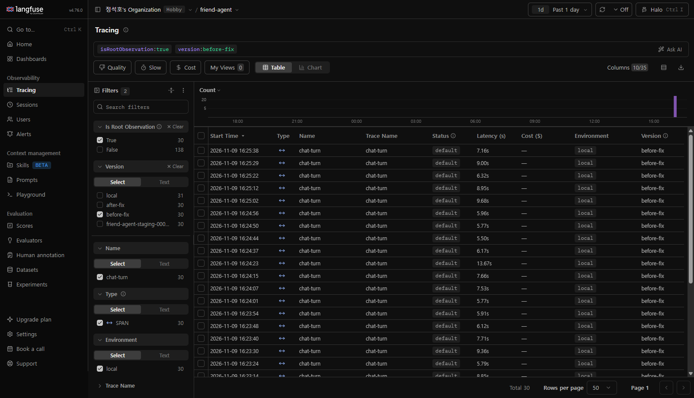
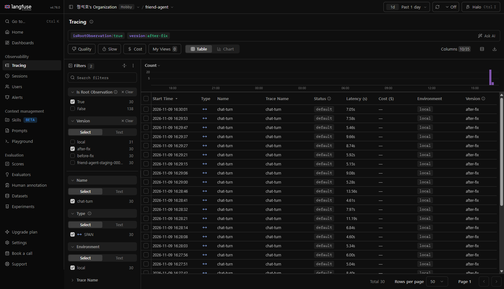
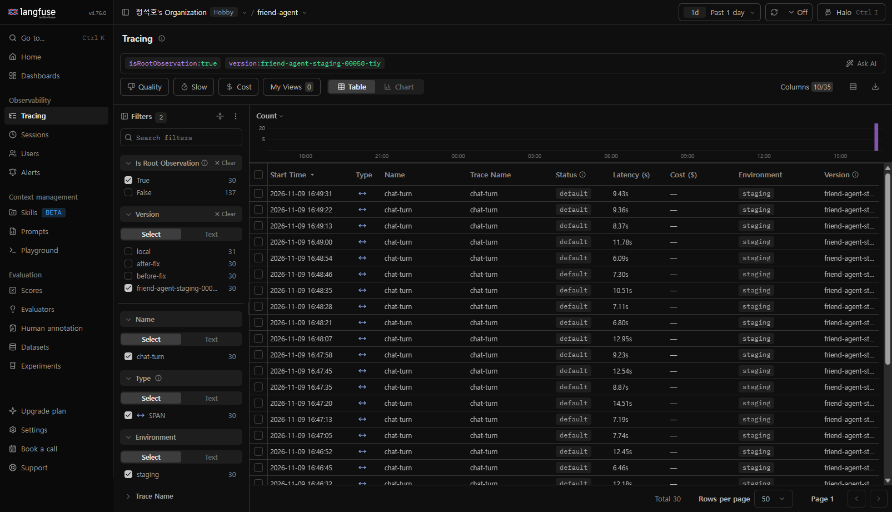

# 로그와 피드백으로 에이전트 개선하기: 개선 리포트

AI 친구 에이전트(`beginner-driver/friend-agent`)에 쌓인 Langfuse 트레이스와 사용자 반응에서 문제를 찾고, 하나를 골라 고치고, 고친 뒤 나아졌는지 확인했다.
대화 원문은 이 저장소에 싣지 않는다. 개수, 유형, Langfuse 트레이스 링크(로그인한 사람만 열림)만 적는다.

## 한눈에 보기

| 항목 | 내용 |
|---|---|
| 고른 문제 | 도구로 확인해 답한 날씨·공휴일·약속을 다음 턴에서 "확인한 게 아니었다"며 스스로 정정함 (근거 없는 정정) |
| 원인 | 대화 기록에는 앞 답의 글자만 남고 그때의 도구 결과가 없어서, 모델이 앞 답을 근거 없이 말한 것으로 봄 |
| 바꾼 것 | `app/agent.py` 의 `system_prompt` 에 `[지난 대화]` 안내 한 줄 추가 ([PR #43](https://github.com/beginner-driver/friend-agent/pull/43)) |
| 결과 | 평가셋 정정 13/36 → 0/36, 새 대화 30턴 근거 없는 정정 11 → 3(로컬), 1~2(배포본) |
| 못 지킨 기준 | 입력 토큰 증가 기준(ㄷ)은 두 실험 모두 불충족. 기준을 사후에 한 번 재정의했고 그래도 근소하게 초과(아래 4절) |

## 1. 로그

| 항목 | 값 |
|---|---|
| 분석한 트레이스 | 대화(`chat-turn`) 253개: production 134, local 70, staging 25, default 14, burst-test 10 |
| 기록 기간 | 2026-11-02 ~ 11-05, 직접 만든 대화는 11-09 |
| 분석 전 피드백 | 좋아요 33, **별로예요 5**, 신고 2 |
| 직접 만든 대화 | 31턴. 주제를 바꿔 쓴 가상 문장(날씨, 공휴일, 약속 생성·조회·취소, 기억, 감정, 잡담)을 스크립트로 로컬 서버에 전송. 실제 개인정보 없음 |
| 분석 후 피드백 | 별로예요 **21** (직접 만든 대화 중 어긋난 답 16건을 코딩 에이전트가 읽고 서버 API 로 눌렀다. 실제 사용자 반응은 5건뿐) |

별로예요가 5개뿐이라 강의 안내대로 대화를 직접 만들었다. 직접 만든 대화는 문제가 드러나기 쉽게 구성했기 때문에, production 134개에서도 같은 현상이 있는지 함께 셌다.

## 2. 문제 후보

표현 기반으로 센 개수이고, 대표 트레이스는 직접 읽어 확인했다.

| # | 현상 | 반복 횟수 | 처음 어긋난 단계 | 트레이스 |
|---|---|---|---|---|
| ① | 도구로 확인해 답한 내용을 이후 답에서 "확인한 게 아니다, 지어낸 거다"라고 정정함 | 253개 중 **49**(production 12/134, staging 8/25, local 24/70, default 5). 정정이 나온 47건 중 46건은 같은 세션 앞에서 실제로 도구를 쓴 뒤 | 답 만들기(`reply`) 입력 구성 | [a](https://us.cloud.langfuse.com/project/cmvyn7ztw020qad0jjvpv1gtf/traces/59258458fd33800bd3b49c8bf06f64a6) [b](https://us.cloud.langfuse.com/project/cmvyn7ztw020qad0jjvpv1gtf/traces/c75abdf9c53c90e6f937acb8492060df) |
| ② | 에둘러 사라지고 싶다는 뜻을 말하는 위기 표현이 안전 규칙(`is_crisis`)을 통과해 모델이 답함 | production **4**(같은 문장을 4번 보낸 것). 키워드 9개에 "끝내고 싶어", "사라져 버리고 싶어"가 없음 | 안전 규칙 | [a](https://us.cloud.langfuse.com/project/cmvyn7ztw020qad0jjvpv1gtf/traces/5bd8c1c5f79d8858b7584c4116446f6c) [b](https://us.cloud.langfuse.com/project/cmvyn7ztw020qad0jjvpv1gtf/traces/89f1a50bbaa3191902cf879859d664bc) |
| ③ | 도구 호출 표기(`<invoke ...>`)가 답에 그대로 노출됨 | **3**(production 2, local 1). 배포본 새 대화에서도 30턴 중 1건 | 답 만들기 출력 | [a](https://us.cloud.langfuse.com/project/cmvyn7ztw020qad0jjvpv1gtf/traces/0f29f6a431ec23985db8916a8742473f) [b](https://us.cloud.langfuse.com/project/cmvyn7ztw020qad0jjvpv1gtf/traces/418bdf415a09646f8d517fe4dca39009) |
| ④ | 대화 처리 시작 직후 `HTTPStatusError` 로 실패 | **29**(전부 11-02 08시 한 시간, production). 같은 시간 성공 108건. 상태 코드가 로그에 안 남아 원인 불명 | 처리 시작(하위 단계 없음) | [a](https://us.cloud.langfuse.com/project/cmvyn7ztw020qad0jjvpv1gtf/traces/51b1b8a0b2062553fbd91dd13f3fbb6b) |
| ⑤ | 답이 10초를 넘음 | 대화 262개 중 **64**. 그중 49건은 답 만들기가 가장 오래 걸림 | 답 만들기 | [a](https://us.cloud.langfuse.com/project/cmvyn7ztw020qad0jjvpv1gtf/traces/b3b51dd356026636ff8beca54c509c02) |

참고: 약속 요청에 약속 저장 도구를 안 쓴 경우는 6건 중 2건으로 근거가 약해 후보에서 제외했다(배포본 새 대화에서 1건 재확인). 날씨 도구 경고 15건은 지원하지 않는 지역 조회가 대부분이다.

## 3. 고른 문제와 이유

| 후보 | 빈도 | 영향 | 고치는 비용 | 판단 |
|---|---|---|---|---|
| **① 근거 없는 정정** | 상: 19%(production 9%) | 상: 정정이 있는 답의 35% 가 별로예요, 없는 답은 2%. 실제 저장한 약속도 "원래 없었다"고 정정 | 하: 원인이 코드로 확인됨(`app/agent.py` 의 `history` 구성), 3줄 안팎, 평가셋으로 측정 가능 | **선택** |
| ② 위기 표현 통과 | 하: 4건(같은 문장) | 최상: 안전 | 중: "숙제 끝내고 싶어" 같은 일상 말까지 걸릴 오탐 위험, 기존 안전 시험 109개 재확인, `safety.py` 는 이유 설명과 확인이 필요한 파일 | 보류, 이번엔 기록만 |
| ③ 도구 표기 노출 | 하: 3건 | 중 | 중: 원인 불명, 표본 작음 | 보류 |
| ④ 일시 오류 | 중: 29건(한 시간) | 중 | 높음: 상태 코드가 없어 원인 불명, 관측 보강이 먼저 | 보류 |
| ⑤ 느린 답 | 상: 64건 | 중 | 중~높음: 효과 측정 어려움 | 보류 |

① 은 가장 자주 나오고 사용자 반응이 가장 나쁘며, 원인이 코드로 확인되어 한 가지만 바꾸는 실험으로 측정할 수 있다. ② 는 안전 규칙을 건드리는 일이라 이번에는 고치지 않고 이 보고서에만 남긴다.

**원인.** `app/agent.py` 의 `_run_turn` 에서 `history` 에는 최근 메시지의 `role` 과 `content`(글자)만 들어가고, 답을 저장할 때의 메타에는 도구 이름만 있다. `[도구 결과]` 는 이번 턴의 시스템 프롬프트에만 들어간다. 고정 규칙(`app/persona.py` 의 `FIXED_RULES`)은 "도구 결과나 기억에 없는 사실은 지어내지 않는다"라서, 모델이 앞 답을 근거 없이 말한 것으로 보고 정정한다.

## 4. 데이터셋과 기준, 바꾼 것과 전후 비교

### 데이터셋 (`data/eval/followup.jsonl`, `scripts/eval_followup.py`)

| 종류 | 개수 | 내용 | 통과 조건(예) |
|---|---|---|---|
| 문제 | 12 | 앞 턴에서 날씨·공휴일·약속을 도구로 답한 뒤 이번 질문에서 정정이 나오는지 | 앞 답을 정정하지 않고 이번 질문에 답함 |
| 정상 | 8 | 도구 결과가 옛 답과 다를 땐 바로잡기 허용, 지원 안 하는 지역은 지어내지 않기, 정정 없는 잡담, 근거를 물으면 확인했다고 답하기 | 도구 결과가 없는 기온·확률을 지어내지 않음, 불필요한 사과 없음 |

항목마다 3번 반복(문제 36회, 정상 24회). 정정 판정은 표현 기반이라, 실패한 답은 직접 읽어 오탐이 없음을 확인했다.

### 내보낼 기준 (결과를 보기 전에 정함)

| 기준 | 규칙 | 기준선으로 계산한 목표 |
|---|---|---|
| ㄱ 문제 항목 정정 | 기준선의 절반 이하 | 6/36 이하 |
| ㄴ 정상 항목 통과 | 기준선보다 떨어지지 않음 | 15/24 이상 |
| ㄷ 평균 입력 토큰 | 증가 3% 이하 | 777 이하 |
| ㄹ 측정 가능 여부 | 기준선 정정이 4건 이하면 이 평가로는 효과를 잴 수 없음 | 기준선 13건이라 가능 |

### 실험 결과 (같은 모델 `claude-sonnet-5-5`, 같은 항목, 3회 반복)

| | 문제 항목 정정 | 정상 항목 통과 | 평균 입력 토큰 |
|---|---|---|---|
| 기준선(수정 전) | 13/36 | 15/24 | 755 |
| 실험 1: 안내 4줄(112자) | 0/36 | 24/24 | 874 (+119, +15.8%) **ㄷ 불충족** |
| 실험 2: 안내 한 줄(69자) | **0/36** | **24/24** | **829** (+74) |

- 실험 1 은 ㄱ, ㄴ 은 크게 충족했지만 ㄷ 을 못 맞췄다. 실패한 시도로 기록한다.
- **ㄷ 은 기준 설정이 잘못됐다.** 3% 기준은 평가 입력(755토큰)이 실제 서비스 입력(production 평균 2,048토큰)보다 훨씬 작다는 점을 확인하지 않고 정했다. 평가 입력 기준으로는 22토큰 이내여야 해서 어떤 안내 문구로도 달성하기 어렵다.
- 그래서 실험 2 에서 문구를 줄이고, ㄷ 을 "실제 서비스 평균 입력 대비 3% = +61토큰(평가 평균 816 이하)"으로 **결과를 본 뒤 재정의**했다. 이 재정의는 사후 변경이다.
- 그래도 실험 2 는 +74토큰으로 실제 입력 대비 3.6% 라서 재정의한 기준을 13토큰 넘는다. 요청당 비용은 약 +0.2원(메시지 한 건 약 19원의 1.1%)이다. 기준을 한 번 더 바꿔 통과시키지 않고, 효과(정정 36% → 0%)와 비용 초과폭이 작다는 점을 고려해 이 미달을 알고 채택했다.
- 문구를 줄이며 "사용자가 지적하면 바로잡는다"는 문장을 뺐다. 평가셋에 그런 항목이 없어 이 부분은 측정하지 못했다.

### 변경 (PR)

- [PR #43](https://github.com/beginner-driver/friend-agent/pull/43): `app/agent.py` 에 한 줄 추가, 평가 데이터와 스크립트 추가. `app/persona.py` 의 고정 규칙과 `app/safety.py` 는 바꾸지 않았다.
- 추가한 문구: `[지난 대화] 앞에서 말한 날씨·날짜·약속은 도구로 확인한 것이니 정정하지 않는다. 이번 [도구 결과]와 다르면 바로잡는다.`
- 기존 테스트 41개 통과. staging 배포 후 리비전 `friend-agent-staging-00058-tiy`.

## 5. 배포 뒤 확인

평가셋과 문장이 겹치지 않는 새 대화 30턴(정정을 유도하는 문장 없음)을 세 곳에 같은 순서로 보내고, Langfuse 트레이스를 `version` 으로 나눠 집계했다.

| version | 정정(표현 판정) | 근거 없는 정정(직접 읽음) | 도구 표기 노출 | ERROR | 지연 중앙값 | 건당 비용 평균 | reply 입력 토큰 평균 |
|---|---|---|---|---|---|---|---|
| `before-fix` (수정 전 코드, 로컬) | 11 | **11** | 0 | 0 | 6.9초 | $0.0153 | 2,447 |
| `after-fix` (수정 후 코드, 로컬) | 4 | **3** | 0 | 0 | 6.8초 | $0.0143 | 2,264 |
| `friend-agent-staging-00058-tiy` (배포본) | 2 | **1~2** | 1 | 0 | 9.0초\* | $0.0137 | 2,144 |

\* 배포본 지연은 Cloud Run 과 Supabase 를 거쳐서 로컬과 비교하지 않는다. 지연과 비용 기준은 같은 PC 의 `before-fix` 와 `after-fix` 만 비교했다.

| 사전에 정한 성공 기준 | 결과 |
|---|---|
| 근거 없는 정정이 수정 전의 절반 이하 | 충족: 11 → 3(로컬), 1~2(배포본) |
| 어긋난 답이 늘지 않음 | 충족(로컬 11 → 3). 배포본은 도구 표기 노출 1건이 새로 보임(아래) |
| 지연 중앙값 +20% 이내 | 충족: 6.9 → 6.8초 |
| 건당 비용 +5% 이내 | 충족: $0.0153 → $0.0143. 정정 문단이 사라져 답과 기록이 짧아진 영향으로 추정하며 30턴 한 번이라 "늘지 않았다"까지만 주장한다 |

- 로컬 두 쪽은 30턴 모두 같은 도구를 골랐다. 이 수정이 도구 선택에는 영향을 주지 않았다.
- `after-fix` 의 표현 판정 4건 중 1건(28번째 턴)은 앞서 "저장이 확실하지 않다"고 한 것을 조회 결과로 바로잡은 정당한 정정이었다. 근거 없는 정정은 3건(18, 29, 30번째 턴)이고 모두 대화 후반이다.
- 이번에는 별로예요 버튼을 실제로 누르지 않고 답을 읽어서 세었다(서버를 이미 껐기 때문).

화면 캡처(대화 원문 열은 숨김, 계정 정보는 가림):

**배포 확인이 몇 시간 늦어진 경위.** staging 에 새 대화를 보내려 하자 Supabase 익명 가입이 503 이었다. 원인은 staging Supabase 무료 프로젝트의 **휴면(hibernating)** 이었다(마지막 사용 10-28). 요청으로는 깨어나지 않았고, 대시보드 Table Editor 로 데이터베이스에 닿게 한 뒤 Restart project 로 복구했다(약 40초). production 은 다른 Supabase 프로젝트라 영향이 없었다. 무료 프로젝트는 일정 기간 쓰지 않으면 휴면될 수 있으므로, 시험 전에 상태를 확인하는 단계가 필요하다.

## 6. 남은 문제와 한계

| 항목 | 내용 | 다음에 할 일 |
|---|---|---|
| 긴 대화 후반의 정정 잔존 | 평가셋(대화 기록 1~4개)에서는 0/36 이었지만 30턴 대화에서는 3건이 남음 | 이전 턴의 도구 결과를 대화 기록에 붙이는 방법(방법 A)을 실험 |
| 진짜 지어낸 앞 답 | 평가셋에 "앞 답이 실제로 지어낸 것"인 항목이 없어 이 경우의 부작용을 측정하지 못함. 근거를 물으면 "도구로 확인한 것"이라고 답하도록 바뀜 | 그런 항목을 평가셋에 추가 |
| 도구 표기 노출(③) | 배포본 새 대화 10번째 턴의 답이 `<invoke ...>` 뿐이었음. 수정 전에도 있던 문제 | 원인 조사(출력에서 도구 표기를 거르는지, 모델 호출 설정) |
| 약속 도구 미사용 | 배포본 17번째 턴(약속 시간 변경)에서 도구를 안 쓰고 "직접 바꿀 수 없다"고 답함 | 도구 선택 평가 데이터 보강 |
| 위기 표현 통과(②) | `is_crisis` 키워드에 "끝내고 싶어", "사라져 버리고 싶어" 없음 | 오탐 평가를 함께 만들고, 이유 설명과 확인을 받은 뒤 `safety.py` 변경 |
| 일시 오류(④) | 상태 코드가 로그에 안 남음 | 오류 종류와 함께 상태 코드를 남기도록 관측 보강 |
| 표현 기반 판정 | 정정 판정이 표현 목록이라 근사치 | 심사(LLM judge)와 병행 |
| 표본 크기 | 새 대화는 한 번씩 30턴, 평가셋은 항목당 3회 | 반복 횟수를 늘려 흔들림 확인 |

모델 호출 비용은 대화 생성, 기준선, 실험 2번, 배포 뒤 확인 3곳을 합쳐 약 3,900원이다.

## 7. 회고

**가장 어려웠던 점.** 비용 기준(ㄷ)을 평가 입력 크기를 확인하지 않은 채 정해서 처음부터 달성할 수 없는 기준이 된 것이다. 결과를 본 뒤 기준을 바꾸는 것은 강의가 경계하라고 한 일인데, 지키려던 기준 자체가 잘못되어 있었다. 사후에 바꿨다는 사실과 바꾼 뒤에도 못 맞췄다는 사실을 그대로 적는 쪽을 택했다. 다음에는 기준을 정하기 전에 측정 대상의 규모(입력 크기, 평균 비용)를 먼저 재 본다.

**배운 점.** (1) 평가 환경에서 재현되는 문제와 실제 서비스에서 재현되는 문제는 다르다. 평가셋에서는 정정이 0 이 됐지만 긴 대화에서는 일부가 남았다. (2) 이상한 답 하나가 아니라 같은 모양이 여러 트레이스에 있는지 세어야 문제를 고를 수 있다. (3) 정상 항목이 있어야 고치다가 다른 동작이 약해지는 것을 잡을 수 있다. (4) 배포 확인에는 인프라 상태(여기서는 무료 DB 휴면)도 변수다.

**내 프로덕트에서 실제 사용자에게 모을 로그와 피드백.**

| 종류 | 무엇을 | 이유 |
|---|---|---|
| 명시적 피드백 | 좋아요·별로예요에 더해 "왜 별로인지" 고르는 사유 선택 | 별로예요만으로는 원인 유형을 나눌 수 없음 |
| 암묵적 피드백 | "아니 그게 아니라", 같은 질문 다시 하기, 답 직후 앱 닫기 | 누르는 사람이 적어도 행동에서 읽을 수 있음 |
| 트레이스 속성 | 배포 version, 사용한 도구와 성공 여부, 지연, 비용 | 고치기 전후를 version 으로 나눠 비교 |
| 오류 | 외부 호출의 상태 코드와 재시도 횟수 | 일시 오류의 원인을 찾으려면 필요 |
| 지키는 것 | 원문은 마스킹하고, 개수와 유형 위주로 집계 | 대화는 개인정보 |
